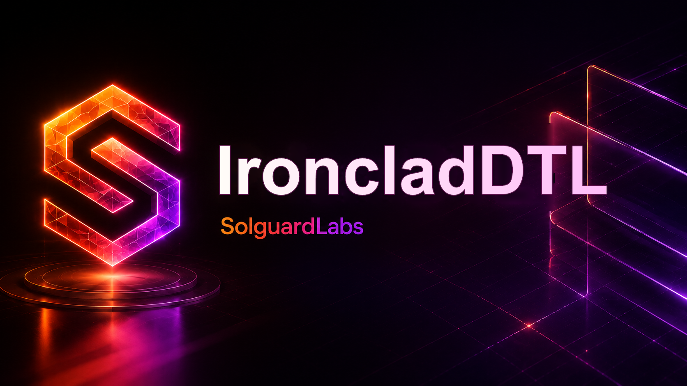

# IroncladDTL



IroncladDTL es un laboratorio CTF escrito en Go. Modela un sistema de bovedas
con reservas bloqueadas por compromisos de entrega: un sponsor deposita fondos,
los divide entre beneficiarios, registra entregas, aplica penalizaciones y cierra
subcompromisos.

Los tests TypeScript ejecutan el binario y validan locks, unlocks, retiros,
penalizaciones y cierre de compromisos. El lab contiene un fallo intencional en
los locks compuestos: si un compromiso dividido alcanza un umbral agregado de
entrega, el lock padre se libera completo aunque algunos subcompromisos sigan
pendientes.

## Uso

Compilar:

```bash
node scripts/build.mjs
```

Ejecutar un fixture:

```bash
build/ironcladdtl run tests/fixtures/composite_exploit.json --json --events
```

Validar un fixture:

```bash
build/ironcladdtl validate tests/fixtures/base_lifecycle.json
```

Tests:

```bash
npm test
```

## Componentes

- `src/ledger.go`: transiciones contables y bug de unlock compuesto.
- `src/types.go`: entidades de dominio, politicas y operaciones.
- `src/report.go`: salida JSON determinista para los tests.
- `src/risk.go`: calculo de exposicion economica y shortfall.
- `src/audit.go`: checks, warnings y trazabilidad.
- `src/cli.go`: CLI `ironcladdtl`.

## Estado

Este repositorio es un CTF autocontenido. No debe usarse como sistema financiero
real ni como implementacion de bovedas productivas.
