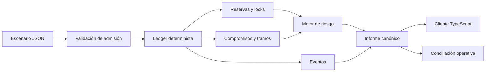
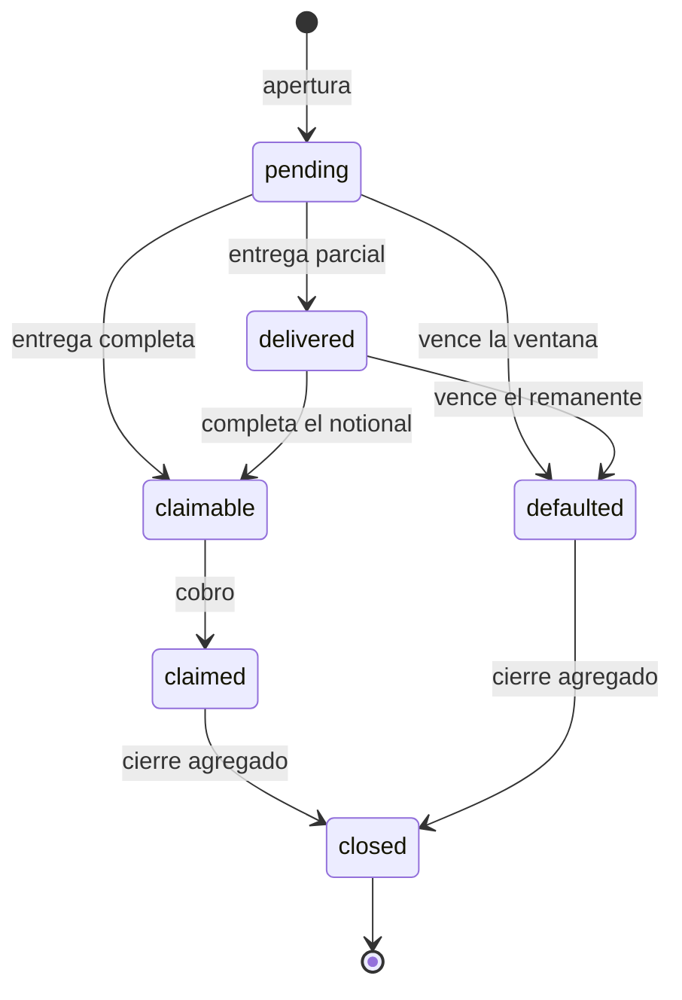

# IroncladDTL


IroncladDTL es un motor determinista de compromisos de entrega y liquidación
por tramos. Permite reservar un activo, asignar derechos a uno o varios
beneficiarios, registrar entregas, aplicar políticas de vencimiento y producir
un estado contable reproducible para conciliación.

El núcleo está escrito en Go y se distribuye como un binario autocontenido. Un
cliente TypeScript ofrece una interfaz tipada para automatizaciones, pruebas de
integración y herramientas operativas.

## Capacidades

- compromisos individuales y multibeneficiario;
- reservas por activo y cuenta de comisiones por bóveda;
- ventanas de entrega expresadas en épocas deterministas;
- penalizaciones sobre notional pendiente;
- cobros parciales configurables y cierre explícito;
- salida JSON canónica, eventos ordenados y rechazos estructurados;
- análisis de cobertura, liquidez por horizonte y concentración;
- ejecución local sin base de datos ni servicios remotos.

## Arquitectura



La transición de estado se ejecuta en memoria y en orden. Cada operación queda
aplicada o rechazada de forma completa; el informe final ordena todas las
colecciones por identificador para que dos ejecuciones equivalentes produzcan
el mismo resultado.

## Modelo de compromiso

Un sponsor inmoviliza un notional `N` en una bóveda. El compromiso puede
dividirse en `k` tramos, cada uno con importe `aᵢ`, beneficiario y vencimiento:

```text
N = Σ aᵢ, para i = 1..k
0 < aᵢ ≤ N
```

La entrega acumulada se representa en puntos básicos:

```text
delivered_bps = floor(delivered × 10_000 / amount)
```

Las cantidades usan enteros de 64 bits y todas las multiplicaciones de tasas
se realizan mediante funciones acotadas. No se emplea coma flotante en el
ledger.

## Estados principales



El lock padre representa la política agregada del compromiso; los locks de
tramo conservan el seguimiento individual de cada beneficiario. Los eventos
incluyen el cursor, la época y las claves de dominio necesarias para reconstruir
la ejecución.

## Inicio rápido

Requisitos:

- Go 1.22 o posterior;
- Node.js 24 o posterior;
- Bash para ejecutar los scripts de validación.

Instalación y compilación:

```bash
npm ci
npm run build
```

Ejecutar un escenario:

```bash
./build/ironcladdtl run tests/fixtures/base_lifecycle.json --json --events
```

En Windows:

```powershell
.\build\ironcladdtl.exe run tests\fixtures\base_lifecycle.json --json --events
```

Validar un escenario sin aplicarlo:

```bash
./build/ironcladdtl validate tests/fixtures/composite_closure.json
```

## Formato de entrada

```json
{
  "name": "shipment-cycle-042",
  "epoch": 120,
  "policy": {
    "default_penalty_bps": 800,
    "default_release_threshold_bps": 10000,
    "grace_epochs": 2,
    "allow_partial_claims": true
  },
  "accounts": [
    { "id": "sponsor", "label": "Sponsor", "reserves": { "iusd": 250000 } },
    { "id": "carrier", "label": "Carrier", "reserves": { "iusd": 0 } },
    { "id": "treasury", "label": "Treasury", "reserves": { "iusd": 0 } }
  ],
  "vaults": [
    { "id": "settlement-usd", "asset": "iusd", "reserve": 0, "fee_account": "treasury" }
  ],
  "operations": [
    {
      "type": "open",
      "id": "shipment-042",
      "account": "sponsor",
      "vault": "settlement-usd",
      "beneficiary": "carrier",
      "amount": 50000,
      "due_epoch": 125
    },
    {
      "type": "deliver",
      "id": "delivery-proof-042",
      "commitment": "shipment-042",
      "beneficiary": "carrier",
      "amount": 50000
    },
    { "type": "settle", "commitment": "shipment-042" },
    { "type": "claim", "id": "claim-042", "commitment": "shipment-042", "beneficiary": "carrier" },
    { "type": "close", "commitment": "shipment-042" }
  ]
}
```

## Cliente TypeScript

```ts
import { IroncladClient } from "./client/ironclad-client.ts";

const client = new IroncladClient();
const snapshot = client.simulate("tests/fixtures/base_lifecycle.json", {
  events: true,
});

console.log(client.summarize(snapshot));
```

El cliente ejecuta el binario sin shell, aplica un tiempo máximo y valida la
salida JSON antes de exponerla al consumidor.

## Modelo de cobertura

El evaluador de estrés separa cuatro horizontes: inmediato, cercano, término y
largo. La liquidez disponible se calcula después del haircut de reserva y de la
realización conservadora de comisiones:

```text
available = reserve × (1 - reserve_haircut)
          + fees × fee_realization

buffered_claims = expected_claims × (1 + liquidity_buffer)
coverage_bps    = available × 10_000 / buffered_claims
funding_gap     = max(buffered_claims - available, 0)
```

La concentración se mide por beneficiario sobre el total de derechos activos.
El detalle completo, incluidos los supuestos de probabilidad y recuperación,
está en [docs/modelo-economico.md](./docs/modelo-economico.md).

## Verificación

```bash
# Pruebas Go y Node
npm test

# Verificación completa usada por CI
npm run ci

# Solo pruebas del motor
go test ./...

# Solo integración por CLI
npm run test:node
```

La integración continua se ejecuta en Ubuntu y Windows. Comprueba formato Go,
análisis estático, pruebas, compilación, superficie pública, metadatos de
versión y determinismo de los escenarios.

## Estructura

```text
.
├── client/                  # cliente TypeScript
├── docs/                    # arquitectura y operación
├── scripts/                 # build y verificaciones reproducibles
├── src/                     # ledger, riesgo, informes y CLI
├── tests/
│   ├── fixtures/            # escenarios públicos de referencia
│   ├── helpers/             # adaptadores de prueba
│   └── node/                # integración de extremo a extremo
├── README.md
└── SECURITY.md
```

## Documentación

- [Arquitectura](./docs/arquitectura.md)
- [Modelo económico](./docs/modelo-economico.md)
- [Modelo de seguridad](./docs/modelo-seguridad.md)
- [Integración](./docs/integracion.md)
- [Operación](./docs/operacion.md)
- [Gobernanza de parámetros](./docs/gobernanza.md)

## Release

La serie estable actual es `Production 1.0.0`. La rama `production`, el tag
anotado `v1.0.0` y el commit publicado deben converger en el mismo SHA.

Consulta [CHANGELOG.md](./CHANGELOG.md) para el detalle del release y
[SECURITY.md](./SECURITY.md) para el alcance de los controles.
