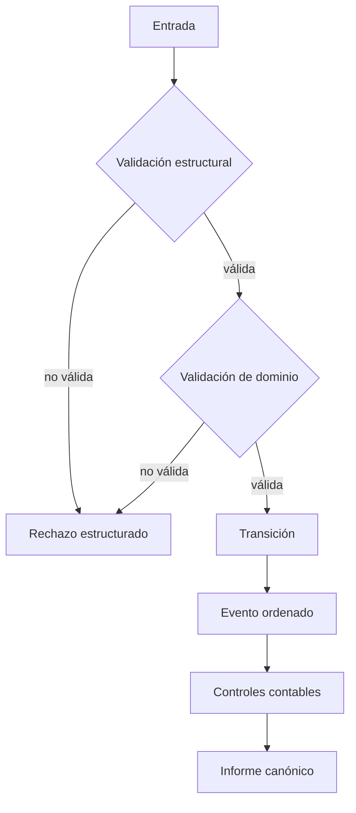
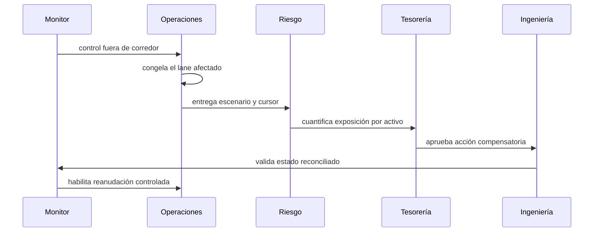

# Política de seguridad

## Modelo de confianza

IroncladDTL procesa escenarios declarativos y produce una transición de estado
determinista. La frontera de confianza está formada por:

- el archivo de escenario suministrado por el operador;
- el binario compilado desde una versión identificada;
- la política incluida en el escenario;
- el sistema que consume el informe JSON.

El proceso no abre puertos, no accede a una base de datos y no requiere secretos
para ejecutar el motor. El cliente TypeScript invoca el binario directamente,
sin interpolar argumentos en una shell.

## Versiones mantenidas

| Versión | Estado | Rama |
| --- | --- | --- |
| 1.0.x | mantenida | `production` |
| `< 1.0.0` | fuera de mantenimiento | — |

## Invariantes

Las revisiones deben comprobar, como mínimo:

1. Ninguna cuenta ni bóveda termina con saldo negativo.
2. La suma de los tramos coincide con el notional del compromiso.
3. Un identificador no se reutiliza dentro del mismo dominio.
4. Una entrega no supera el importe del tramo.
5. Las penalizaciones quedan acotadas al remanente no entregado.
6. Cada evento tiene una secuencia estrictamente creciente.
7. Los rechazos esperados no producen efectos parciales.
8. La salida mantiene un orden canónico para entradas equivalentes.
9. Las operaciones aritméticas detectan overflow antes de mutar el estado.
10. Los parámetros en puntos básicos permanecen dentro de `[0, 10_000]`.

## Capas de control

### Admisión

- identificadores obligatorios y únicos;
- importes positivos y acotados;
- cuentas, bóvedas y beneficiarios existentes;
- vencimientos compatibles con la época actual;
- desglose completo del notional compuesto.

### Ejecución

- suma y resta comprobadas;
- cálculo de tasas mediante enteros;
- aplicación secuencial de operaciones;
- registro explícito de operaciones rechazadas;
- estados monotónicos por tramo y lock.

### Observabilidad

- cursor de evento incremental;
- códigos de error estables;
- métricas de reserva, derechos activos y cobertura;
- línea temporal por época;
- acciones operativas derivadas de vencimientos y gaps de liquidez.

### Cadena de entrega

- dependencias de acciones fijadas por versión mayor;
- `npm ci` sobre lockfile;
- `go vet` y `go test` en Linux y Windows;
- tag estable anotado;
- verificación de convergencia entre `main`, `production` y tag.

## Validación de entradas

El motor presupone que el archivo es JSON UTF-8, pero no confía en su contenido.
Los errores se clasifican como `validation`, `not_found`, `conflict` o
`insufficient_funds`. Un escenario puede declarar `expect_error` para modelar
un rechazo operativo esperado; cualquier otro error interrumpe la ejecución.

No se deben usar campos `note` para transportar secretos. Los escenarios, los
eventos y los informes están diseñados para ser material operativo observable.

## Respuesta ante incidentes

El expediente debe conservar:

- versión y SHA del binario;
- hash del escenario de entrada;
- cursor inicial y final;
- informe JSON completo;
- parámetros efectivos;
- decisión de contención y responsable;
- resultado de la conciliación.

## Reporte responsable

Un reporte técnico debe incluir versión, plataforma, precondiciones, entrada
mínima, resultado observado, resultado esperado e impacto contable. No incluyas
secretos, credenciales ni datos de terceros.

Los detalles sensibles deben mantenerse fuera de issues, discusiones y pull
requests públicos hasta que la revisión haya concluido.

## Exclusiones

No se consideran hallazgos de seguridad por sí solos:

- diferencias visuales del informe humano;
- ausencia de persistencia, red o autenticación en el binario local;
- límites de negocio modificados de forma explícita en el escenario;
- rechazo documentado de importes sin saldo suficiente;
- orden canónico diferente entre versiones mayores documentadas.

## Lista de revisión

- [ ] El caso usa un commit identificable.
- [ ] La entrada se valida con `ironcladdtl validate`.
- [ ] El resultado se reproduce dos veces de forma idéntica.
- [ ] `npm run ci` termina correctamente.
- [ ] El informe no contiene datos sensibles.
- [ ] El impacto está expresado por activo y unidad.
- [ ] La propuesta conserva las invariantes contables.
