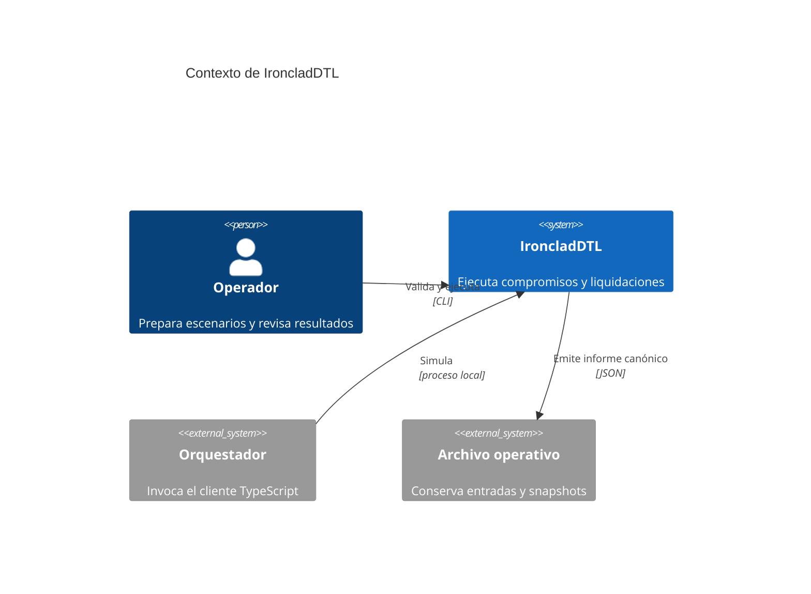
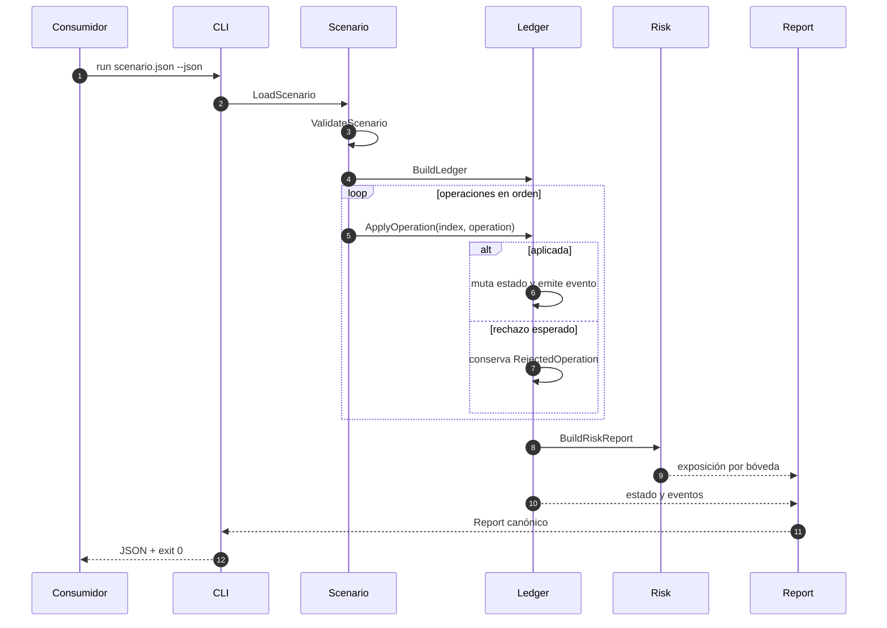

# Arquitectura de IroncladDTL

## Objetivo

IroncladDTL separa la descripción de una operación, la transición contable y la
presentación del resultado. El diseño favorece ejecuciones pequeñas,
reproducibles y auditables sin infraestructura auxiliar.

## Contexto

## Componentes

| Componente | Responsabilidad | Entrada | Salida |
| --- | --- | --- | --- |
| `scenario.go` | carga y validación estructural | JSON | `Scenario` |
| `ledger.go` | transición secuencial | operaciones | estado + eventos |
| `amount.go` | aritmética monetaria | enteros y tasas | importes acotados |
| `risk.go` | exposición vigente | ledger | cobertura por bóveda |
| `stress.go` | escenarios de liquidez | claims + parámetros | horizontes y gaps |
| `audit.go` | controles y planificación | ledger + riesgo | checks y acciones |
| `report.go` | proyección canónica | estado completo | JSON ordenado |
| `cli.go` | interfaz de proceso | argumentos | código de salida |

## Flujo de ejecución

## Identidad y agregados

El modelo distingue cuatro espacios de identidad:

- cuenta: propietario de reservas externas;
- bóveda: reserva de un activo y cuenta de comisiones;
- compromiso: contrato agregado del sponsor;
- tramo: derecho individual de un beneficiario.

Los locks son registros técnicos derivados. Un compromiso compuesto contiene un
lock padre y un lock por tramo. Esta separación permite observar política
agregada y ejecución individual sin duplicar la definición del notional.

## Determinismo

Las fuentes principales de no determinismo se controlan así:

1. Las operaciones se procesan según su posición en el JSON.
2. Los eventos reciben un contador incremental dentro del ledger.
3. Las vistas de mapas se ordenan por identificador antes de serializar.
4. El tiempo se expresa como una época incluida en el escenario.
5. No se usa reloj del sistema, red ni aleatoriedad.

Dos ejecuciones con el mismo binario y la misma entrada deben producir el mismo
informe, salvo el formato humano elegido por el consumidor.

## Límites transaccionales

Cada método del ledger valida sus precondiciones antes de mutar el estado. En
operaciones que afectan a varias entidades, el orden de actualización está
definido dentro de una única llamada síncrona. Los escenarios se consideran la
unidad superior de ejecución: un error no esperado termina el proceso y evita
presentar un informe parcial como resultado válido.

## Extensión

Para añadir una operación:

1. ampliar `Operation` con los campos estrictamente necesarios;
2. validar el tipo en `ApplyOperation`;
3. implementar la transición en `ledger.go` o un módulo de dominio;
4. emitir un evento estable;
5. añadir proyección en `report.go` si modifica la API;
6. cubrir camino nominal, rechazo y orden canónico;
7. actualizar la documentación de integración.

No se deben introducir dependencias de infraestructura dentro del ledger. Los
adaptadores de persistencia o transporte pertenecen fuera del proceso.

## Compatibilidad

La compatibilidad se evalúa sobre:

- nombres y tipos de campos JSON;
- códigos de error;
- estados públicos;
- tipos de evento;
- semántica de épocas y puntos básicos.

Una adición opcional es compatible dentro de la serie `1.0.x`. Renombrar un
campo, cambiar una unidad o reinterpretar un estado requiere una versión mayor.
