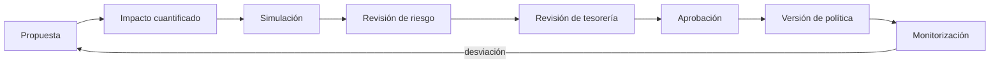

# Gobernanza de parámetros

## Principio

Los parámetros económicos forman una política versionada. Una modificación
afecta admisión, valoración o operación y necesita propietario, justificación,
pruebas y fecha de entrada en vigor.

## Clases

| Clase | Parámetros | Propietario primario |
| --- | --- | --- |
| Admisión | mínimo y máximo de compromiso | producto + riesgo |
| Entrega | umbral agregado y gracia | operaciones |
| Penalización | tasa por defecto | riesgo |
| Fees | comisión de release | tesorería |
| Cobro | pagos parciales | operaciones + tesorería |
| Estrés | haircut, default, recovery, buffer | riesgo |
| Concentración | límite por beneficiario | riesgo |

## Proceso



## Expediente mínimo

Una propuesta debe indicar:

- identificador y propietario;
- valor actual y propuesto;
- activos y lanes afectados;
- motivo y horizonte;
- escenarios nominal, adverso y extremo;
- efecto sobre cobertura, gap y concentración;
- compatibilidad con entradas existentes;
- plan de reversión;
- aprobadores y fecha efectiva.

## Cambios conjuntos

Default y recovery deben analizarse juntos. Haircut y buffer también, porque
ambos reducen la holgura disponible desde lados distintos del balance. El
umbral de concentración no debe elevarse para compensar un gap de liquidez.

## Ejemplo de decisión

```yaml
id: POL-2026-0042
scope: iusd/settlement-usd
effective_epoch: 840
changes:
  reserve_haircut_bps: [500, 650]
  liquidity_buffer_bps: [1250, 1500]
evidence:
  nominal_coverage_bps: 12840
  adverse_coverage_bps: 11120
  extreme_funding_gap: 425000
approvals:
  risk: approved
  treasury: approved
rollback_epoch: 842
```

## Simulación

La evaluación debe mantener idéntico el conjunto de derechos y variar solo los
parámetros bajo revisión. Para evitar sesgo:

1. fijar el hash de entrada;
2. ejecutar la política actual;
3. ejecutar la propuesta;
4. comparar cada horizonte;
5. revisar concentración y madurez ponderada;
6. conservar ambos snapshots.

## Límites de autoridad

- Operaciones puede proponer ventanas y gracia.
- Riesgo puede proponer haircuts, default, recovery y concentración.
- Tesorería aprueba cualquier cambio que modifique liquidez disponible o fees.
- Ingeniería valida representabilidad, overflow y compatibilidad.
- Ningún propietario aprueba en solitario su propia propuesta.

## Reversión

Una reversión crea una nueva versión; no borra el expediente anterior. Debe
definir una época futura y comprobar que las entradas en curso se interpretan
con la política que les corresponde.

## Revisión periódica

La política se revisa cuando ocurra cualquiera de estos eventos:

- cambio material de volumen;
- concentración fuera de corredor;
- dos periodos consecutivos con cobertura decreciente;
- incorporación de un activo;
- modificación de unidades o escala;
- cambio de versión mayor del motor.
