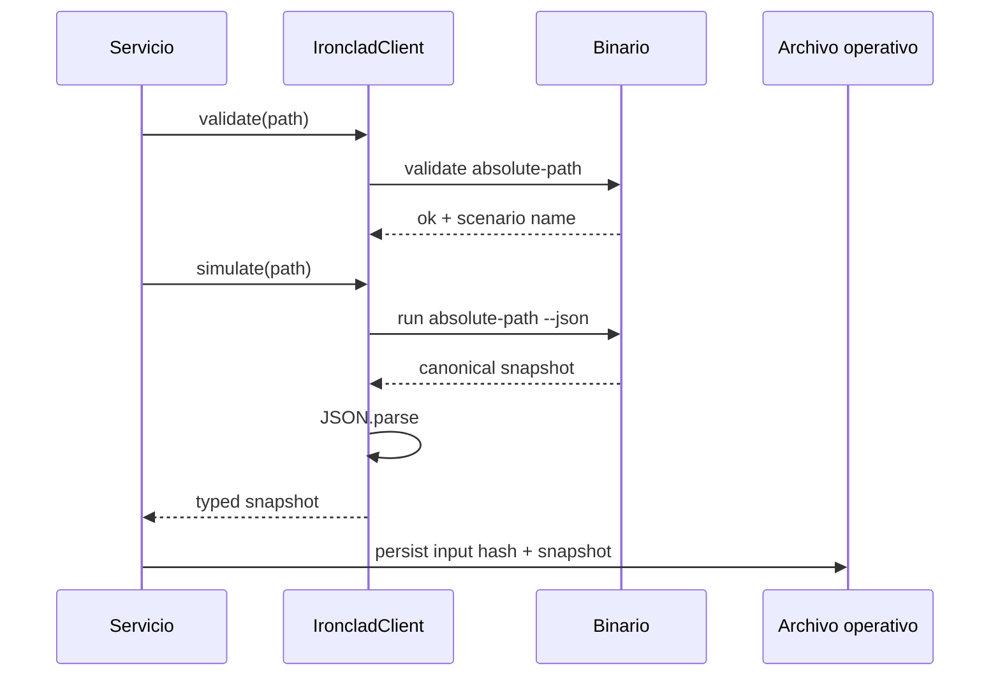

# Integración

## Opciones

IroncladDTL se integra mediante proceso local:

1. CLI directa para jobs, terminales y pipelines.
2. Cliente TypeScript para servicios Node.js.
3. Consumo del informe JSON desde cualquier lenguaje.

No existe un daemon ni un protocolo de red propio.

## Contrato de proceso

| Código | Significado |
| ---: | --- |
| `0` | validación o ejecución completada |
| distinto de `0` | argumento, entrada o transición no válida |

`stdout` contiene el resultado solicitado. Los errores operativos se escriben
en `stderr`. Con `--json`, una ejecución correcta produce un único documento
JSON.

## Comandos

```text
ironcladdtl run <scenario> [--json] [--compact] [--events]
ironcladdtl validate <scenario>
ironcladdtl scenarios
ironcladdtl help
```

`--events` incluye el stream completo. Sin esa opción, el informe conserva la
línea temporal agregada y omite el detalle para reducir tamaño.

## Cliente TypeScript

```ts
import { IroncladClient } from "./client/ironclad-client.ts";

const client = new IroncladClient({
  root: process.cwd(),
  timeoutMs: 20_000,
});

client.validate("inputs/daily-settlement.json");
const snapshot = client.simulate("inputs/daily-settlement.json");
const summary = client.summarize(snapshot);
```

El objeto de resumen está congelado. El snapshot se tipa como solo lectura para
evitar que una capa de presentación parezca modificar el resultado del motor.

## Esquema de consumo



## Estabilidad del JSON

Dentro de `1.0.x`:

- los campos existentes no cambian de tipo;
- los estados existentes conservan su significado;
- pueden añadirse campos opcionales;
- las listas permanecen ordenadas por ID;
- los códigos de error se mantienen estables.

Los consumidores deben ignorar campos desconocidos y no depender del orden de
las propiedades de un objeto.

## Idempotencia

El motor no conserva estado entre procesos. Repetir una ejecución con el mismo
archivo produce el mismo snapshot. La idempotencia externa se consigue
archivando:

```text
input_sha256
binary_sha256
protocol_version
snapshot_sha256
```

Un orquestador debe rechazar la reutilización del mismo identificador de lote
con un hash de entrada diferente.

## Errores

Ejemplo de rechazo dentro de un escenario:

```json
{
  "index": 4,
  "type": "withdraw",
  "id": "withdrawal-044",
  "code": "insufficient_funds",
  "field": "amount",
  "message": "requested amount exceeds available reserve"
}
```

Un rechazo declarado con `expect_error: true` se incorpora al informe y la
ejecución continúa. Si no se esperaba, el proceso termina con error.

## Rendimiento

La implementación está orientada a lotes acotados. Mapas e índices ofrecen
acceso constante a entidades, mientras que las proyecciones finales ordenan
colecciones con coste `O(n log n)`.

Para entradas grandes:

- limitar operaciones por archivo;
- ejecutar un proceso por activo o ventana;
- conservar el informe sin eventos si no se necesita trazabilidad completa;
- medir memoria con datos representativos antes de ampliar límites.

## Compatibilidad Windows

El build produce `build/ironcladdtl.exe`. El cliente detecta la plataforma y
resuelve ese nombre automáticamente. Las rutas se normalizan con `path.resolve`
y se pasan como argumentos, por lo que admiten espacios.
