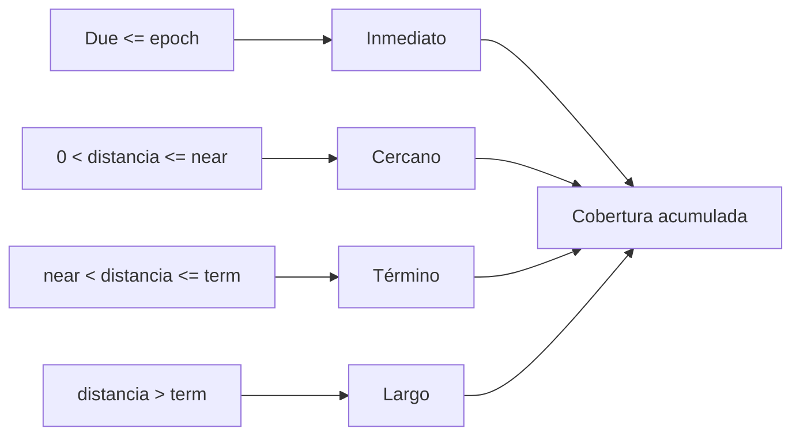

# Modelo económico

## Unidades

Todos los importes son enteros `int64`. El activo define la escala fuera del
motor; IroncladDTL conserva unidades mínimas sin convertir decimales. Las tasas
usan puntos básicos, donde `10.000 = 100 %`.

```text
rate(amount, bps) = floor(amount × bps / 10_000)
```

Cuando una reserva debe cubrir una obligación conservadora se utiliza redondeo
hacia arriba.

## Balance del compromiso

Para un compromiso con notional `N`, tramos `aᵢ`, cobros `cᵢ`, penalizaciones
`pᵢ`, comisiones `f` y residual del sponsor `r`:

```text
N = Σ aᵢ
outstandingᵢ = max(aᵢ - cᵢ - pᵢ, 0)
```

La conciliación de cierre contrasta los acumulados del compromiso con sus
tramos antes de proyectar el estado terminal.

## Progreso de entrega

Cada tramo mantiene un acumulado entregado. El ratio no supera `10.000`:

```text
delivery_ratioᵢ = floor(min(deliveredᵢ, aᵢ) × 10_000 / aᵢ)
```

La entrega completa habilita el cobro. El remanente vencido se somete a la
política de penalización.

## Penalización

Sea `m` el importe no entregado y `q` la tasa configurada:

```text
penalty = min(ceil(m × q / 10_000), m)
```

La penalización incrementa las comisiones de la bóveda y reduce el lock del
tramo por el mismo importe. El barrido de comisiones transfiere únicamente el
saldo contabilizado como fees.

## Liquidez disponible

El modelo de estrés no modifica el ledger. Recibe un snapshot y calcula una
vista conservadora:

```text
reserve_after_haircut = reserve × (10_000 - haircut_bps) / 10_000
realizable_fees       = fees × realization_bps / 10_000
available_liquidity   = reserve_after_haircut + realizable_fees
```

Para un derecho pendiente, la probabilidad económica combina cumplimiento y
recuperación:

```text
performance_bps = 10_000 - default_bps
recovered_bps   = default_bps × recovery_bps / 10_000
base_bps        = performance_bps + recovered_bps
claim_bps       = max(base_bps, delivered_bps)
expected_claim  = ceil(amount × claim_bps / 10_000)
```

Los estados `claimable` y `delivered` se valoran al 100 % porque ya existe una
prestación completa o una entrega registrada pendiente de liquidación.

## Buffer y cobertura

```text
buffer       = ceil(expected_claim × liquidity_buffer_bps / 10_000)
buffered     = expected_claim + buffer
funding_gap  = max(total_buffered - available_liquidity, 0)
coverage_bps = available_liquidity × 10_000 / total_buffered
```

Si no existen derechos activos, la cobertura se representa como `10.000`.

## Horizontes



La cobertura de cada horizonte es acumulada: el bucket cercano incluye las
necesidades inmediatas, y así sucesivamente. De este modo puede detectarse una
tensión de plazo aunque el total final permanezca dentro del corredor.

## Concentración

Para cada beneficiario `b`:

```text
concentration_bps(b) = claims(b) × 10_000 / total_claims
```

La lista se ordena por importe descendente y, en empate, por identificador. El
resultado incluye la concentración máxima y si se mantiene bajo el límite de
política.

## Ejemplo

Supuestos:

| Parámetro | Valor |
| --- | ---: |
| Reserva | 200.000 |
| Haircut | 5 % |
| Comisiones | 10.000 |
| Realización de fees | 80 % |
| Derechos esperados | 142.000 |
| Buffer | 12,5 % |

Resultado:

```text
reserve_after_haircut = 190.000
realizable_fees       =   8.000
available_liquidity   = 198.000
buffered_claims       = 159.750
coverage_bps          = 12.394
funding_gap           =       0
```

Una cobertura superior a `10.000` indica holgura frente al escenario, no un
incremento de suministro.

## Parámetros por defecto

| Parámetro | Puntos básicos / épocas |
| --- | ---: |
| Haircut de reserva | 500 bps |
| Realización de comisiones | 8.000 bps |
| Default de contraparte | 1.500 bps |
| Recuperación | 4.000 bps |
| Buffer de liquidez | 1.250 bps |
| Límite de concentración | 3.500 bps |
| Horizonte cercano | 2 épocas |
| Horizonte de término | 8 épocas |

Los parámetros forman un conjunto coherente y deben aprobarse juntos; cambiar
solo una tasa puede desplazar el significado del corredor.
