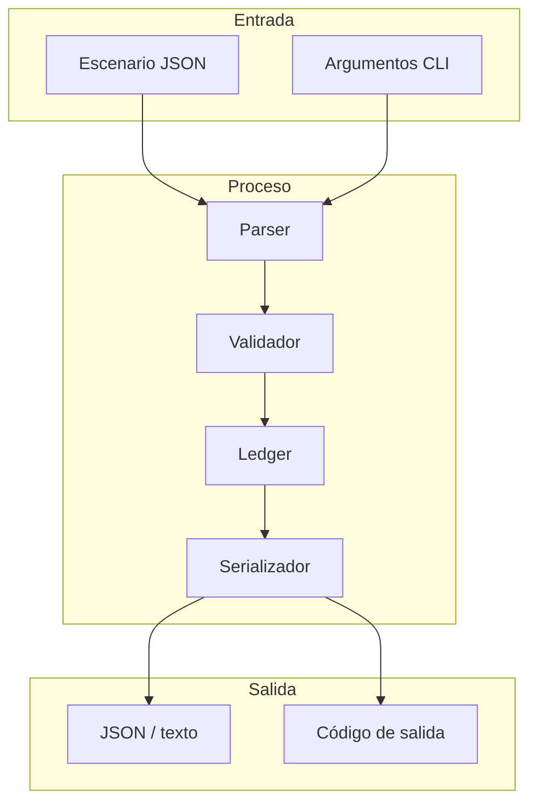
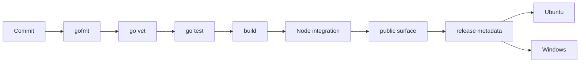

# Modelo de seguridad

## Activos protegidos

- integridad del saldo por cuenta y activo;
- reserva y comisiones por bóveda;
- notional y progreso de cada compromiso;
- derecho individual de cada beneficiario;
- secuencia y contenido de los eventos;
- reproducibilidad del informe canónico;
- integridad de los artefactos de release.

## Actores

| Actor | Capacidad | Supuesto |
| --- | --- | --- |
| Sponsor | abre compromisos y retira saldo propio | su entrada puede ser adversa |
| Beneficiario | entrega y cobra su tramo | solo identifica su propio derecho |
| Tesorería | recibe comisiones | opera sobre una cuenta declarada |
| Operador | ordena el escenario | controla el archivo de entrada |
| Consumidor | procesa el informe | valida versión y esquema |

El motor no autentica identidades externas. La autorización pertenece al
sistema que construye el escenario; el ledger valida coherencia y saldo.

## Superficies



## Riesgos y controles

### Entrada sobredimensionada

El proceso carga el documento completo en memoria. El orquestador debe limitar
el tamaño del archivo y el número de operaciones antes de invocar el binario.
El motor limita importes, pero no impone un límite global de bytes.

### Aritmética

`AddAmount`, `SubAmount`, `MulBps` y `MulBpsCeil` validan overflow y dominio.
Las funciones monetarias no convierten a `float64`.

### Reutilización de identidad

Las inserciones consultan el mapa de dominio y rechazan duplicados. Los
consumidores no deben interpretar dos tipos distintos con el mismo ID como la
misma entidad.

### Comandos del cliente

El cliente usa `spawnSync` con `shell: false`, ruta absoluta y tiempo máximo.
Las rutas de escenario se entregan como argumento separado; no se concatenan
en una cadena de comandos.

### Información en eventos

Los eventos contienen identificadores, importes y detalles de política. No
deben contener secretos. Si el sistema superior trabaja con datos regulados,
debe sustituir identificadores por referencias opacas antes de construir el
escenario.

### Dependencias

El binario usa únicamente la biblioteca estándar de Go. Node se usa para build,
cliente y verificación; el proyecto no declara dependencias de ejecución npm.
Dependabot revisa módulos Go, npm y acciones de GitHub.

## Controles de CI



Un cambio no está listo si solo compila. Deben pasar ambas plataformas y los
dos workflows sobre el mismo SHA.

## Integridad del release

El tag estable es anotado. Para una publicación final:

```text
commit(main) = commit(production) = commit(v1.0.0)
```

El workflow de integridad obtiene el historial completo, comprueba el tipo del
objeto tag y compara las referencias remotas. La release se crea únicamente
después de que el job del tag termine correctamente.

## Registro de decisiones

Las decisiones que cambien unidades, estados, política agregada o semántica de
eventos deben documentarse antes de modificar el código. La justificación debe
incluir migración, compatibilidad y pruebas de regresión.

## Revisión manual recomendada

- límites entre cuenta, bóveda, compromiso y tramo;
- orden de mutaciones en operaciones multientidad;
- redondeos en tasas y fees;
- transiciones de vencimiento y gracia;
- consistencia entre ledger, riesgo e informe;
- interpretación del estado por el cliente TypeScript.
