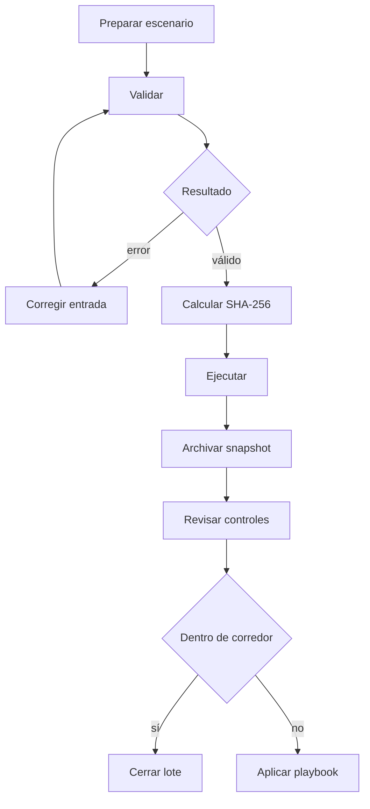

# Operación

## Ciclo diario



## Preflight

Antes de ejecutar un lote:

```bash
git status --short
git rev-parse HEAD
npm ci
npm run build
./build/ironcladdtl validate path/to/scenario.json
```

Registrar SHA del commit, del binario y de la entrada. La validación correcta
no sustituye la revisión de parámetros económicos.

## Ejecución

```bash
./build/ironcladdtl run path/to/scenario.json --json --events > snapshot.json
sha256sum path/to/scenario.json build/ironcladdtl snapshot.json
```

Para un lote rutinario puede omitirse `--events`; durante una revisión o una
reconciliación debe conservarse el stream completo.

## Indicadores

| Indicador | Fuente | Uso |
| --- | --- | --- |
| `total_reserve` | `metrics` | liquidez física |
| `total_economic_claims` | `metrics` | derechos abiertos |
| `economic_shortfall` | `metrics` | gap inmediato |
| `rejected_operations` | `metrics` | calidad del lote |
| `claimable_subs` | `metrics` | cola de pagos |
| `pending_subs` | `metrics` | trabajo vigente |
| `coverage_bps` | `risk.vaults` | cobertura por bóveda |

Las alertas deben usar corredores aprobados por activo, no un único umbral
global.

## Conciliación

Para cada activo:

1. sumar reservas de cuentas;
2. sumar reserva y fees de bóvedas;
3. agrupar notional y derechos por compromiso;
4. revisar operaciones rechazadas;
5. comparar cursor final con el evento archivado;
6. calcular la vista de estrés con los parámetros vigentes.

Una diferencia debe expresarse en unidades mínimas del activo y vincularse al
primer cursor donde aparece.

## Rotación y archivo

Conservar juntos:

```text
YYYY-MM-DD/
  input.json
  input.sha256
  snapshot.json
  snapshot.sha256
  execution.json
```

`execution.json` debe incluir versión, commit, hash del binario, plataforma,
hora del orquestador y responsable. El reloj no participa en la ejecución; solo
documenta el expediente.

## Playbook de tensión de liquidez

1. Pausar nuevos compromisos del lane afectado.
2. Mantener disponibles cobros y operaciones de observación autorizadas.
3. Recalcular exposición inmediata, cercana y de término.
4. Confirmar concentración por beneficiario.
5. Preparar una acción compensatoria revisada por tesorería y riesgo.
6. Ejecutar sobre una copia del escenario y comparar hashes.
7. Reanudar tras dos checkpoints dentro del corredor.

## Recuperación

El ledger no persiste estado. La recuperación consiste en volver a ejecutar la
entrada archivada con el mismo binario. Si el hash del snapshot cambia:

- confirmar plataforma y versión;
- comprobar que el binario coincide;
- comparar el primer evento divergente;
- no mezclar salidas de dos versiones en el mismo expediente.

## Runbook de release

```text
feature branch -> PR verde -> merge en main -> CI main verde
              -> branch production -> CI production verde
              -> tag anotado -> integridad del tag verde
              -> release publicada -> integridad de release verde
```

La convergencia se comprueba con:

```bash
git rev-parse origin/main
git rev-parse origin/production
git rev-list -n 1 v1.0.0
```

Los tres valores deben ser idénticos.
